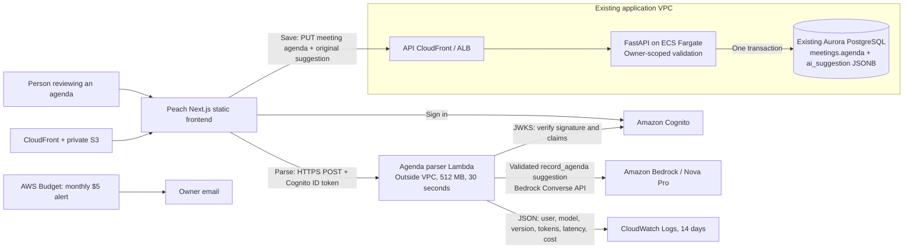

# Peach — C4 container view, Lab 6

The parse arrow never reaches the database. Only the reviewed save path can write.
Peach uses owner isolation (one signed-in user), not a new organisation subsystem.
